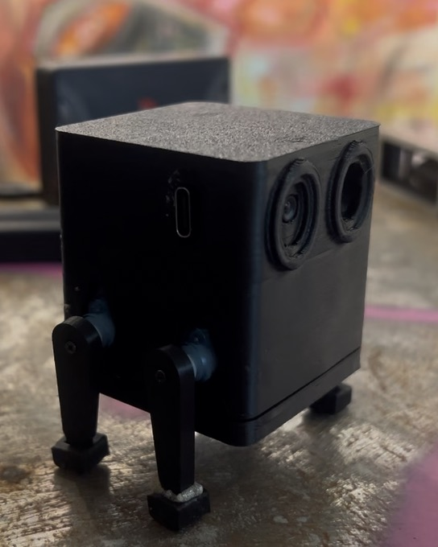
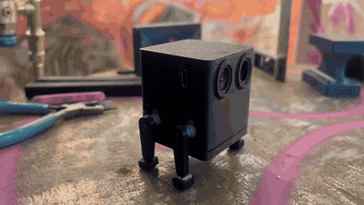
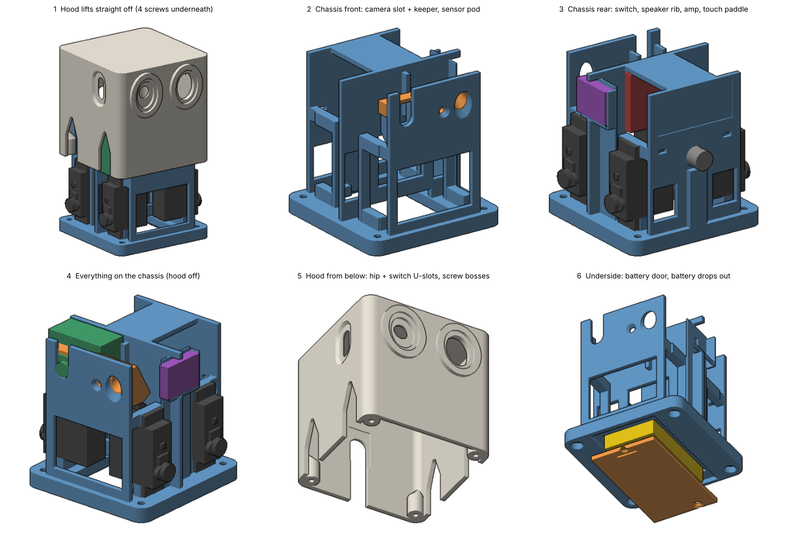
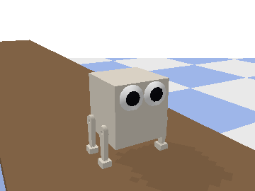

# Cubi

A 48 mm cube, four-legged desk robot that wanders around, watches your face and acts like a puppy. Parts cost under $500. Designed in parametric CAD, trained in a physics sim, printed on a Bambu A1 mini, and **walking on her own on real hardware** since 17 Nov 2026.

<p>
  
  
</p>

Full-quality clip: [media/cubi_walking.mp4](media/cubi_walking.mp4)

| v2 serviceable body (designed) | Simulated walk |
|---|---|
|  |  |

## What she does
- **Walks** on four hip-only legs (one 3.7 g servo each) with a stick-slip gait trained in simulation, then auto-tuned on the real robot with her own distance sensor.
- **Sees faces**: the camera eye runs an on-chip face detector (~11 fps) on the ESP32-S3's second core. She turns to watch you and searches for you when lonely.
- **Avoids edges and walls** with a VL53L0X time-of-flight eye tilted down at the desk.
- **Has a mind**: four personality traits plus energy, curiosity, loneliness and boredom drives pick what she does next. A head tap within 4 s of a trick counts as praise, and that trick gets more likely. Golden retriever mode included.
- **Phone remote** over Wi-Fi, no app install.

## Hardware
| Part | What |
|---|---|
| Brain + camera + mic | Seeed XIAO ESP32S3 Sense |
| Distance eye | VL53L0X on a GY-530 board |
| Legs | 4x GH-S37D micro servo (measured 180 deg) |
| Battery | 1S LiPo 500 mAh, charged over USB-C by the XIAO |
| Voice | MAX98357A I2S amp + 8 ohm micro speaker |
| Touch | Copper tape pad on D0 |
| Power | Mini toggle, 1000 uF + 470 uF bulk caps, no boost converter |

Full BOM: [docs/Cubi_BOM.pdf](docs/Cubi_BOM.pdf). Build plan: [docs/Cubi_Build_Plan.pdf](docs/Cubi_Build_Plan.pdf).

## Repo layout
```
firmware/cubi_fw/      current firmware (single-file Arduino sketch)
firmware/legacy/       original ponder_selftest sketch from the design phase
hardware/v1/           built body: shell v7, flat-battery bottom plate, v2 leg plate
hardware/v1/original/  first-round STLs and the all-parts A1 mini plate
hardware/v2/           serviceable v2 body (hood + chassis), not yet built
hardware/coupons/      fit-test coupons (rule: every new interface gets one)
cad/                   parametric CAD + fit checks (Python, trimesh/manifold3d)
sim/                   PyBullet sim, gait training, mind sim, recorded results
viewers/               browser 3D parts viewer and sim viewer (open the .html)
docs/                  build log, v2 notes, phone remote, climbing concept, PDFs
```

## Flash the firmware
1. Arduino IDE 2.x, ESP32 core **3.0.7**.
2. Board `XIAO_ESP32S3`, PSRAM `OPI PSRAM`, USB CDC On Boot `Enabled`.
3. Library: Pololu VL53L0X.
4. Copy `cubi_secrets.example.h` to `cubi_secrets.h` and set a Wi-Fi password (optional, but do it before running her anywhere public).
5. Open `firmware/cubi_fw/cubi_fw.ino`, upload, Serial Monitor at 115200.

Power her up standing on a clear, smooth surface so the boot distance baseline is right. Useful keys: `M` mind mode, `P` puppy mode, `w`/`b` walk, `c` legs vertical, `T` auto-tune gait, `F` follow your face, `x` stop. The boot log lists the rest.

## Status
Working: walking on smooth surfaces, mind mode on battery, face detection and follow, steering trim, phone remote (pending antenna).

Known issues, honestly:
- No gait works on a rough painted desk. She needs paper, a desk pad or acrylic (grip shoes are designed, not printed).
- Camera, mic and battery sense dropped out after a re-close (Sense board connector unseated). Physical fix pending; v2 body adds a foam shim.
- Distance eye aims ~12-15 deg flatter than designed. v2 has swappable 30/35/40 deg pods.
- Edge reflex not yet confirmed on a real desk edge.

Details: [docs/build-log.md](docs/build-log.md).

## License
MIT. See [LICENSE](LICENSE).
